# Setup

All experiments ran on four CloudLab nodes in the Utah cluster, running Ubuntu 22.04
(kernel 5.15) and connected over a private 10.10.1.0/24 network. The server nodes
(node0, node2) have 48 CPUs each.

| Node  | Role                                                   |
| :---- | :----------------------------------------------------- |
| node0 | iperf3 server, nginx server (single and multi node)    |
| node1 | iperf3 client, vegeta attacker (single and multi node) |
| node2 | nginx server (multi node)                              |
| node3 | vegeta attacker (multi node)                           |

**Network.** iperf3 3.9 in UDP mode, node1 to node0, 10 s per run, offered bandwidth
from 100 to 1000 Mbit/s in steps of 100, 10 runs per step.

**Web server.** nginx with `worker_processes 1`, serving a static page. Both servers serve the 22-byte page in `src/app/index.html`. An earlier single-node run,
where node0 still served Ubuntu's 612-byte default page, was repeated and is not used. Before each
experiment the attack scripts check over SSH that exactly one worker process exists. Load was
generated with vegeta 12.12.0, an open-loop generator: it sends at the requested rate
regardless of how fast responses come back. Each run lasts 30 s, followed by a 5 s
cooldown, with 10 runs per rate. While each run is active, `pidstat` samples the CPU
usage of the nginx worker once per second. Because a single worker runs on a single
core, 100% means that core is fully busy. The CPU figures below average only the
samples that fall inside the attack window, matched by timestamp; the idle seconds
before and after are excluded.

**Multi node.** Both attackers start at the same scheduled time. Each sends half of the
aggregate rate, alternating requests between node0 and node2, so each server receives
half of the aggregate rate. Both attackers saved vegeta JSON reports
and ran their own CPU monitors on both servers; server CPU is the mean of the two
monitors. The multi-node experiment was first run with node0 still serving the
612-byte default page while node2 served the 22-byte page, so the servers did unequal
work. That first attempt is split over two sessions: `final_20261011_231515` (2000 to
38000 req/s) and `final_20261012_080851` (38000 to 44000 req/s). After node0 was fixed
the full experiment was repeated, and only that repeat (session
`final_20261012_134628`) is analysed below.

**Statistics.** Every value is the mean over 10 runs, given as mean ± 95% confidence
interval (Student t, 9 degrees of freedom). The _saturation point_ is the last rate
before throughput first falls below 95% of the offered load. _Capacity under a p99
target_ is the last rate before the mean p99 latency first exceeds that target. If no
tested rate fails the criterion, the point is reported as not reached. The analysis
code is in `analysis/`.

\newpage

# Network

| Offered (Mbit/s) | Goodput (Mbit/s) |      Loss (%) | Jitter (ms) | Client CPU (%) | Server CPU (%) |
| ---------------: | ---------------: | ------------: | ----------: | -------------: | -------------: |
|              100 |      100.0 ± 0.0 | 0.000 ± 0.000 |      0.0059 |            6.4 |            8.0 |
|              200 |      200.0 ± 0.0 | 0.000 ± 0.000 |      0.0132 |           11.0 |           17.0 |
|              300 |      300.0 ± 0.0 | 0.000 ± 0.000 |      0.0099 |           16.1 |           24.7 |
|              400 |      400.0 ± 0.0 | 0.000 ± 0.000 |      0.0079 |           21.3 |           32.4 |
|              500 |      500.0 ± 0.0 | 0.000 ± 0.000 |      0.0062 |           26.4 |           40.9 |
|              600 |      600.0 ± 0.0 | 0.000 ± 0.000 |      0.0052 |           31.7 |           48.7 |
|              700 |      700.0 ± 0.0 | 0.000 ± 0.000 |      0.0048 |           36.5 |           57.9 |
|              800 |      799.9 ± 0.0 | 0.002 ± 0.003 |      0.0040 |           41.6 |           62.1 |
|              900 |      899.9 ± 0.0 | 0.002 ± 0.002 |      0.0033 |           47.0 |           69.4 |
|             1000 |     934.0 ± 34.3 | 6.593 ± 3.427 |      0.0042 |           50.5 |           71.4 |

Goodput is the bandwidth the server actually received:
sent × (1 − loss). Up to 700 Mbit/s no packets were lost. At 800 and 900 Mbit/s loss is
about 0.002%. At 1000 Mbit/s the sender still sends 1000 Mbit/s, but the server receives
on average only 934 ± 34 Mbit/s and loss rises to 6.6 ± 3.4%. The runs at
1000 Mbit/s split into two groups: three were essentially lossless (999.9 Mbit/s
received, under 0.01% loss) and seven lost between 7% and 13%. A run that delivers
999.9 Mbit/s of UDP payload cannot be on a 1 GbE link, whose payload ceiling with
1448-byte datagrams is about 956 Mbit/s once Ethernet, IP and UDP overhead is counted.
The link is therefore faster than 1 Gbit/s and was not saturated by this test. The loss
at 1000 Mbit/s more likely comes from the receiving host, for example the socket
buffer overflowing when the single-threaded iperf3 server falls behind; iperf3 does not
report where packets were dropped. Jitter stays below 0.02 ms at every rate.

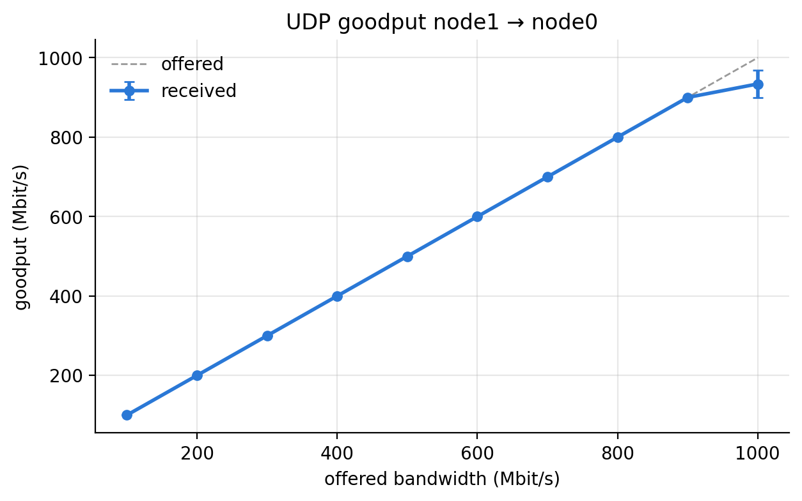{width=72%}

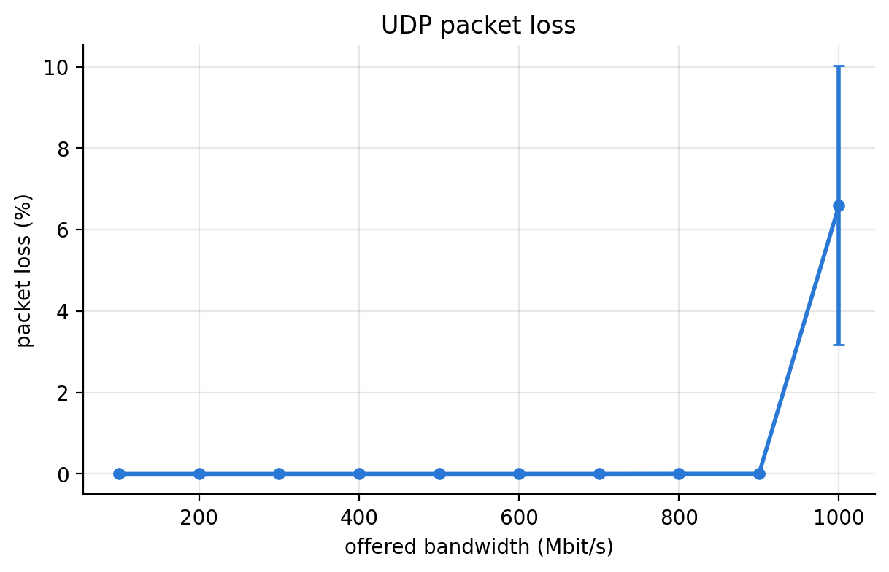{width=72%}

# Single node

| Offered (req/s) | Sent (req/s) | Throughput (req/s) | Success (%) | p50 (ms) | p99 (ms) | node0 CPU (%) | Runs |
| --------------: | -----------: | -----------------: | ----------: | -------: | -------: | ------------: | ---: |
|            1000 |         1000 |           1000 ± 0 |       100.0 |     0.23 |     0.51 |     8.5 ± 0.2 |   10 |
|            2000 |         2000 |           2000 ± 0 |       100.0 |     0.24 |     0.68 |    16.4 ± 0.2 |   10 |
|            3000 |         3000 |           3000 ± 0 |       100.0 |     0.29 |     0.78 |    23.6 ± 0.2 |   10 |
|            4000 |         4000 |           4000 ± 0 |       100.0 |     0.31 |     0.85 |    30.3 ± 1.2 |   10 |
|            5000 |         5000 |           5000 ± 0 |       100.0 |     0.27 |     0.92 |    39.0 ± 0.4 |   10 |
|            6000 |         6000 |           6000 ± 0 |       100.0 |     0.20 |     0.95 |    47.5 ± 0.4 |   10 |
|            7000 |         7000 |           7000 ± 0 |       100.0 |     0.21 |     0.72 |    55.7 ± 0.8 |   10 |
|            8000 |         8000 |           8000 ± 0 |       100.0 |     0.24 |     0.76 |    62.2 ± 0.5 |   10 |
|            9000 |         9000 |           9000 ± 0 |       100.0 |     0.32 |     0.88 |    61.6 ± 2.5 |   10 |
|           10000 |        10000 |          10000 ± 0 |       100.0 |     0.33 |    12.65 |    48.5 ± 0.4 |   10 |
|           12000 |        12000 |          12000 ± 0 |       100.0 |     0.37 |    21.84 |    57.2 ± 0.3 |   10 |
|           14000 |        14000 |          13999 ± 1 |       100.0 |     2.26 |    28.51 |    63.4 ± 1.4 |   10 |
|           16000 |        15999 |          15997 ± 1 |       100.0 |     6.96 |    51.84 |    58.6 ± 1.4 |   10 |
|           18000 |        17999 |          17995 ± 1 |       100.0 |     6.94 |    68.04 |    60.1 ± 0.4 |   10 |
|           19000 |        18998 |          18996 ± 1 |       100.0 |     5.76 |   109.83 |    62.1 ± 0.4 |   10 |
|           20000 |        19996 |              19993 |       100.0 |     9.21 |   105.41 |          65.1 |    1 |

_Sent_ is the rate vegeta actually achieved. _Throughput_ counts successful responses
per second. Only one run at 20000 req/s completed, so that row has no interval and is
provisional.

**Throughput.** node0 served every request at every tested rate, up to 19000 req/s
with ten runs and 20000 req/s with one. The saturation point was not reached.

**Latency.** p99 stays below 1 ms up to 9000 req/s, jumps to 12.7 ms at 10000 req/s,
and reaches 68 ms at 18000 req/s and 110 ms at 19000 req/s. The median starts rising at
14000 req/s (2.3 ms). Requests queue long before throughput suffers.

**Capacity under a p99 target.** 9000 req/s for p99 ≤ 1 ms, 9000 req/s for
p99 ≤ 10 ms, and 18000 req/s for p99 ≤ 100 ms.

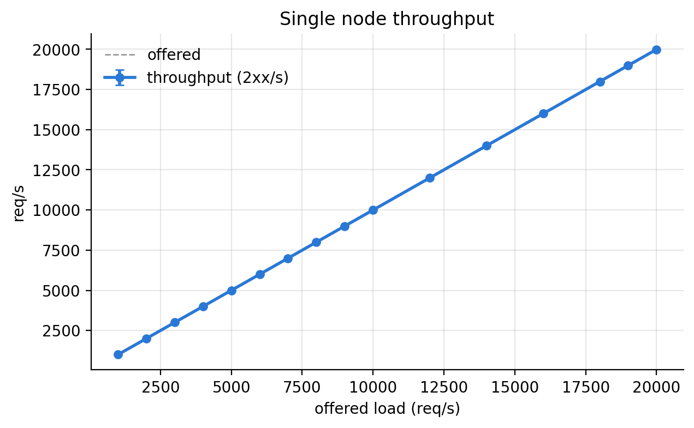{width=72%}

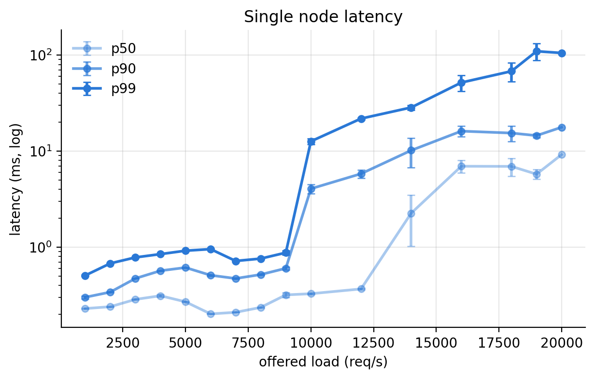{width=72%}

**The worker core is not the limit in the tested range.** At 19000 req/s the worker
uses only 62% CPU, and when p99 first passes 10 ms (10000 req/s) it is at 49%. About
72% of the worker's CPU time is kernel time (`%system`) at every rate, as expected for
a server that mostly moves small buffers through sockets. The network is not the limit
either: 22-byte bodies at 20000 req/s are 3.5 Mbit/s. The latency knee therefore comes
from something the measurements do not cover, such as interrupt handling on other
cores or the attacker itself.

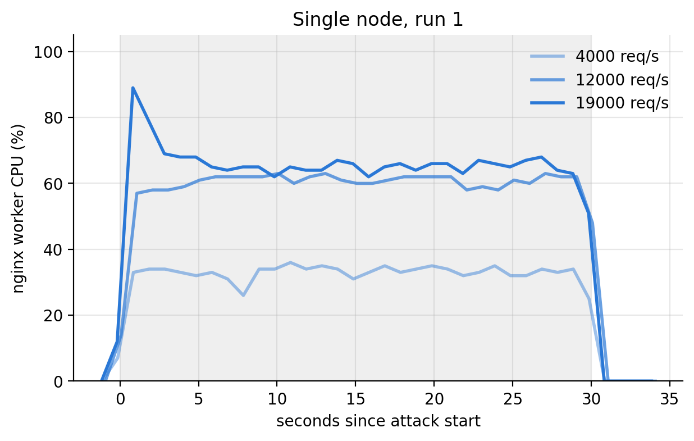{width=72%}

**CPU cost per request falls in steps.** CPU drops from 62.2% at 8000 req/s to 48.5% at
10000 req/s, and again from 63.4% at 14000 req/s to 58.6% at 16000 req/s. The
multi-node servers show the same drops at the same load per server (see Scaling), so
they are a repeatable property of the machines. `pidstat` reports CPU as a share of
time, so a change in clock frequency under rising load could produce drops like these,
and so could more requests handled per `epoll` wakeup. CPU frequency was not recorded,
so neither explanation was verified.

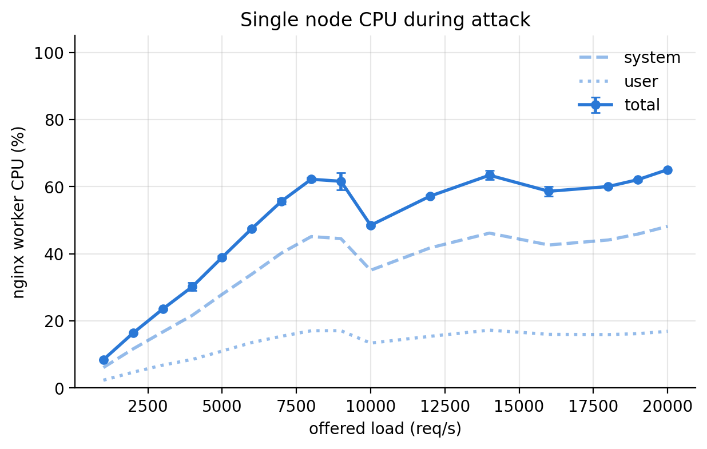{width=72%}

# Multi node

| Offered (req/s) | Sent (req/s) | Throughput (req/s) | Success (%) | Mean (ms) | p99 (ms) | node0 CPU (%) | node2 CPU (%) |
| --------------: | -----------: | -----------------: | ----------: | --------: | -------: | ------------: | ------------: |
|            2000 |         2000 |           2000 ± 0 |       100.0 |      0.25 |     0.54 |     8.3 ± 0.4 |     8.2 ± 0.1 |
|            4000 |         4000 |           4000 ± 0 |       100.0 |      0.26 |     0.69 |    16.7 ± 0.2 |    15.9 ± 0.1 |
|            6000 |         6000 |           6000 ± 0 |       100.0 |      0.29 |     0.75 |    24.0 ± 0.2 |    22.7 ± 0.1 |
|            8000 |         8000 |           8000 ± 0 |       100.0 |      0.32 |     0.81 |    31.9 ± 0.4 |    29.9 ± 0.1 |
|           10000 |        10000 |          10000 ± 0 |       100.0 |      0.29 |     0.83 |    40.2 ± 0.3 |    38.1 ± 0.2 |
|           12000 |        12000 |          12000 ± 0 |       100.0 |      0.26 |     0.74 |    48.0 ± 0.3 |    45.9 ± 0.4 |
|           14000 |        14000 |          14000 ± 0 |       100.0 |      0.28 |     0.73 |    55.9 ± 0.4 |    52.9 ± 0.2 |
|           16000 |        16000 |          16000 ± 0 |       100.0 |      0.32 |     0.80 |    62.1 ± 0.9 |    59.7 ± 0.2 |
|           18000 |        18000 |          18000 ± 0 |       100.0 |      0.45 |     3.38 |    60.4 ± 1.6 |    65.6 ± 0.1 |
|           20000 |        20000 |          20000 ± 0 |       100.0 |      1.23 |    13.25 |    49.4 ± 0.4 |    53.3 ± 1.9 |
|           24000 |        24000 |          24000 ± 0 |       100.0 |      1.70 |    22.30 |    58.5 ± 0.3 |    57.6 ± 0.2 |
|           28000 |        27999 |          27997 ± 1 |       100.0 |      4.04 |    30.20 |    64.6 ± 0.6 |    64.6 ± 0.3 |
|           32000 |        31996 |          31992 ± 2 |       100.0 |      8.64 |    39.95 |    58.8 ± 0.6 |    61.9 ± 0.6 |
|           36000 |        35997 |          35988 ± 1 |       100.0 |     12.55 |    59.20 |    61.8 ± 0.4 |    61.5 ± 0.4 |
|           38000 |        37997 |          37989 ± 4 |       100.0 |     13.55 |    82.65 |    64.0 ± 0.5 |    64.2 ± 0.5 |
|           40000 |        39994 |          39983 ± 3 |       100.0 |     15.30 |   102.37 |    66.9 ± 0.5 |    65.8 ± 0.5 |
|           42000 |        41995 |          41984 ± 3 |       100.0 |     15.96 |   177.09 |    69.6 ± 0.6 |    68.3 ± 0.5 |
|           44000 |        43994 |          43984 ± 3 |       100.0 |     17.05 |   230.34 |    72.7 ± 0.5 |    70.9 ± 0.6 |

Offered, sent and throughput are summed over both attackers. Mean latency is weighted
by request count. vegeta reports only summary percentiles, and percentiles from two
reports cannot be combined exactly, so the p99 column takes the worse of the two
attackers in each run. It is an upper bound on the true combined p99.

**Both servers served the same page.** Every successful response in this experiment was
22 bytes, from both attackers and at every rate. In the first attempt, up to 38000 req/s,
the attackers reported 317 bytes per response, which is (612 + 22) / 2: node0 was
serving the default page and node2 the application page. In the session covering 38000
to 44000 req/s, node0 averaged 86 to 92% CPU while node2 stayed at 64 to 67%, and the
cluster failed from 40000 req/s with connection resets, EOFs, timeouts and ephemeral
port exhaustion. Those failures came from the misconfigured server, not from a cluster limit.

**Throughput.** The two servers served the full offered load at every tested rate, up
to 44000 req/s (43984 ± 3 req/s). Out of about 118 million requests across both
attackers, 3 failed, all with `EOF` errors at 42000 and 44000 req/s. The saturation
point was therefore not reached: it lies above 44000 req/s in total, or above 22000 req/s
per server.

**Latency.** Worst-attacker p99 is below 1 ms up to 16000 req/s, 13.3 ms at
20000 req/s, 82.7 ms at 38000 req/s and 230 ms at 44000 req/s. The per-attacker median
stays below 0.4 ms up to 24000 req/s and reaches about 9 ms at 44000 req/s. Capacity is
16000 req/s for p99 ≤ 1 ms, 18000 req/s for p99 ≤ 10 ms, and 38000 req/s for
p99 ≤ 100 ms. Tail latency grows steadily from 18000 req/s on, so the cluster is
queueing well before it drops any requests.

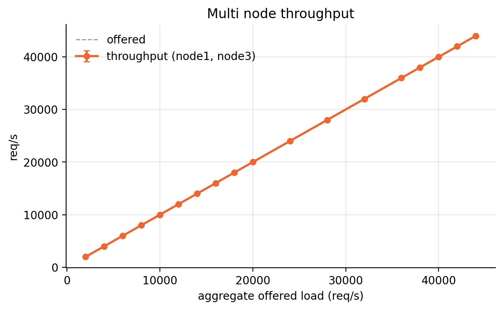{width=72%}

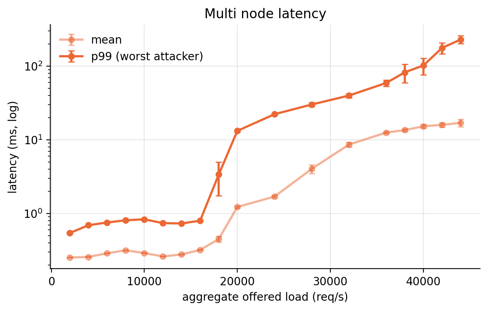{width=72%}

**Load balance.** With identical pages, round-robin splits the work evenly. node0 used
up to 3 percentage points more CPU than node2 up to 16000 req/s; above that the two
curves cross where each one drops, and from 24000 req/s on they stay within
about 3 percentage points of each other. The servers behave as two copies of the same
machine. The attackers, however, did not see the same latency: up to 36000 req/s their
p99 values agree, but at 38000 to 42000 req/s node1's p99 was 35 to 45% higher than
node3's (for example 98 ms against 73 ms at 40000 req/s). Both attackers send to both
servers, so a difference between attackers is unlikely to come from the servers.

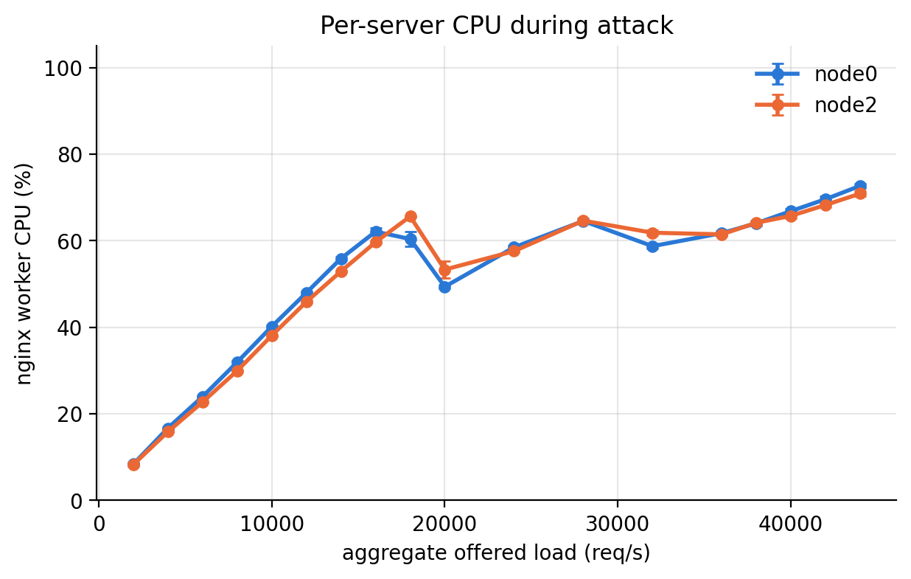{width=72%}

**The worker core is not what limits latency here.** At 44000 req/s each worker uses only
71 to 73% CPU, yet p99 is already 230 ms. p99 starts rising at 18000 req/s (3.4 ms), where
the workers are at 60 to 66%, and reaches 13 ms at 20000 req/s with the workers near
50%. So queueing builds up before the nginx worker's core is
busy. `pidstat` counts only the worker's own time; interrupt and network processing on
other cores is not included, and neither is the attackers' own load. In this design
each attacker always sends at the same rate as the load per server (rate / 2), so a
limit on the attacker side and a limit on the server side would appear at the same
point. The data cannot tell which one causes the queueing.

# Scaling

| Metric                 |      1 server (req/s) |     2 servers (req/s) | Ratio |
| :--------------------- | --------------------: | --------------------: | ----: |
| Saturation point       | not reached (> 20000) | not reached (> 44000) |   n/a |
| Capacity, p99 ≤ 1 ms   |                  9000 |                 16000 |  1.78 |
| Capacity, p99 ≤ 10 ms  |                  9000 |                 18000 |  2.00 |
| Capacity, p99 ≤ 100 ms |                 18000 |                 38000 |  2.11 |

Both setups served the same 22-byte page. Adding a second server roughly doubled every
latency capacity. The 1.78 and 2.11 ratios are step-size effects: the single-node p99 at
10000 req/s is 12.7 ms and at 19000 req/s is 110 ms, so each threshold falls between two
tested rates. Neither setup reached its saturation point.

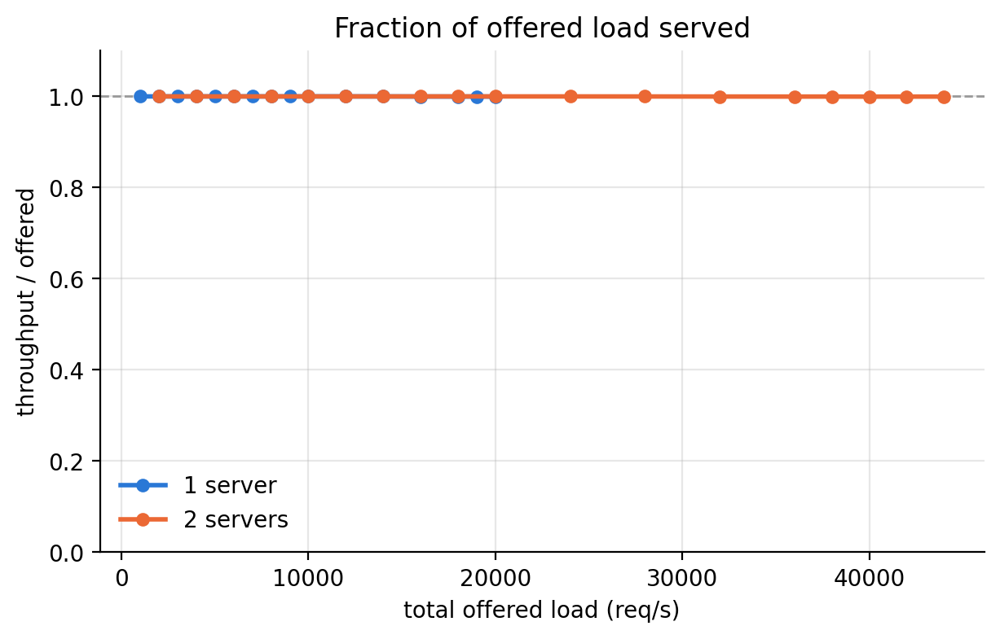{width=72%}

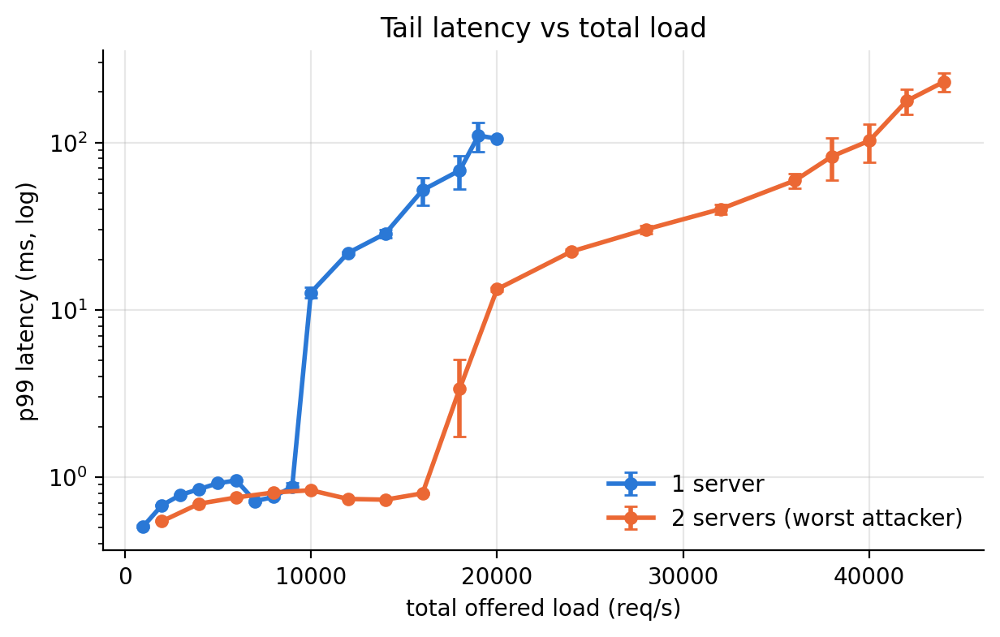{width=72%}

**Equal load per server.** The CPU ratio is the mean CPU of the two multi-node servers
divided by the single-node CPU. p99 for two servers is the worst attacker.

| Load per server (req/s) | 1 server CPU (%) | node0 CPU (%) | node2 CPU (%) | CPU ratio | 1 server p99 (ms) | 2 servers p99 (ms) |
| ----------------------: | ---------------: | ------------: | ------------: | --------: | ----------------: | -----------------: |
|                    1000 |              8.5 |           8.3 |           8.2 |      0.98 |              0.51 |               0.54 |
|                    2000 |             16.4 |          16.7 |          15.9 |      0.99 |              0.68 |               0.69 |
|                    3000 |             23.6 |          24.0 |          22.7 |      0.99 |              0.78 |               0.75 |
|                    4000 |             30.3 |          31.9 |          29.9 |      1.02 |              0.85 |               0.81 |
|                    5000 |             39.0 |          40.2 |          38.1 |      1.00 |              0.92 |               0.83 |
|                    6000 |             47.5 |          48.0 |          45.9 |      0.99 |              0.95 |               0.74 |
|                    7000 |             55.7 |          55.9 |          52.9 |      0.98 |              0.72 |               0.73 |
|                    8000 |             62.2 |          62.1 |          59.7 |      0.98 |              0.76 |               0.80 |
|                    9000 |             61.6 |          60.4 |          65.6 |      1.02 |              0.88 |               3.38 |
|                   10000 |             48.5 |          49.4 |          53.3 |      1.06 |             12.65 |              13.25 |
|                   12000 |             57.2 |          58.5 |          57.6 |      1.02 |             21.84 |              22.30 |
|                   14000 |             63.4 |          64.6 |          64.6 |      1.02 |             28.51 |              30.20 |
|                   16000 |             58.6 |          58.8 |          61.9 |      1.03 |             51.84 |              39.95 |
|                   18000 |             60.1 |          61.8 |          61.5 |      1.03 |             68.04 |              59.20 |
|                   19000 |             62.1 |          64.0 |          64.2 |      1.03 |            109.83 |              82.65 |
|                   20000 |             65.1 |          66.9 |          65.8 |      1.02 |            105.41 |             102.37 |

**A server behaves the same alone or next to another.** At equal load per server, the
multi-node servers used 0.98 to 1.06 times the single server's CPU, the CPU drops
happen at the same loads (10000 and 16000 req/s per server), and p99 passes 10 ms at
10000 req/s per server in both setups. Up to 14000 req/s per server p99 differs by at
most about 3 ms. Above that the multi-node p99 is somewhat lower, but the single-node
20000 req/s point has only one run. Scaling from one server to two is therefore close
to linear: each server carries the same load per server as it would alone.

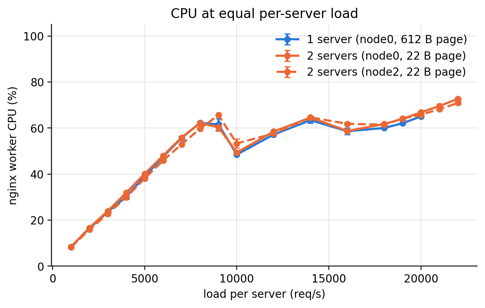{width=72%}

# Conclusions

1. The node1 to node0 path carried UDP up to 900 Mbit/s with negligible loss. At
   1000 Mbit/s three runs were lossless and seven lost 7 to 13%. The link is faster
   than 1 Gbit/s, so its capacity was not reached; the loss most likely occurs at the
   receiver.
2. One nginx worker serving the 22-byte page handled every request up to 19000 req/s
   (ten runs) and 20000 req/s (one run) without saturating; its CPU stayed below 66%.
   Tail latency rises long before throughput suffers: p99 passes 10 ms at
   10000 req/s.
3. Two servers with two attackers served every request up to 44000 req/s and doubled
   the capacity at each p99 target (16000, 18000 and 38000 req/s against 9000, 9000 and
   18000 req/s).
4. At equal load per server, the servers in the two setups used the same CPU and showed
   the same latency knee, so scaling is close to linear. The knee does not follow
   worker CPU, so it comes from a resource the measurements do not cover.
5. With identical pages, round-robin balanced the two servers to within a few
   percentage points of CPU. In the first, misconfigured multi-node attempt, the
   server serving the larger default page limited the whole cluster while the other
   still had spare capacity.

# Limitations

- Neither setup reached its saturation point. The single-node rate list should go
  above 20000 req/s and the multi-node list above 44000 req/s.
- Only one single-node run at 20000 req/s completed.
- Rates were tested in steps of 1000 to 4000 req/s, so each capacity is only known to
  within one step.
- CPU was sampled once per second for the nginx worker only. CPU frequency, interrupt
  distribution, NIC statistics and attacker CPU were not recorded, so neither the
  stepwise drops in CPU cost nor the cause of the latency knee is verified.
- Each attacker always sent at the same rate as the load per server, so a limit on the
  attacker side cannot be separated from a limit on the server side.
