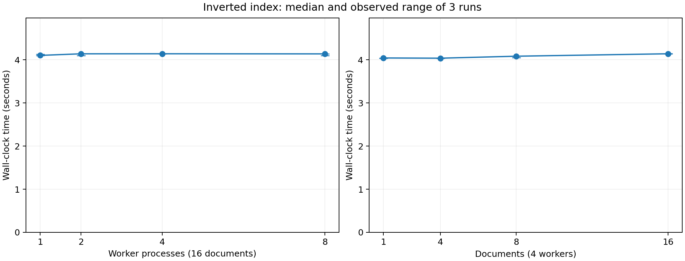

# Assignment 2: Evaluating the inverted index

## Implementation and correctness

The mapper splits on non-Unicode-letter characters and emits case-sensitive word/filename pairs. The reducer removes duplicate filenames, sorts them, and returns `count filenames`. Part A corrected the reducer format and used basename filenames to match the supplied expected output. The supplied corpus test passes. The complete Go framework test suite also passes.

## Method

Machine: AMD Ryzen 7 7735U (8 cores, 16 logical CPUs); Linux-6.12.113+deb13-amd64-x86_64-with-glibc2.41; go version go1.27.1 linux/amd64. CPU affinity permits 16 logical CPUs. Runs used the existing framework unchanged, with three reduce partitions.

Built the executable once, excluding compilation from timing. Each trial starts a fresh master, waits for its socket, and launches independent worker processes. Timing spans master launch through master exit, including registration, scheduling, map/reduce work, shutdown RPCs, and final merge. Remaining idle worker processes are terminated outside timing. The framework uses Unix-domain RPC sockets, so the README’s `localhost:port` arguments are actually local socket filenames, not TCP connections.

Used alphabetically sorted filename prefixes of 1, 4, 8, and 16 files. Each configuration has three trials, shuffled with seed 452. The (4 workers, 16 documents) measurements are shared by both plots. Each trial has an isolated temporary working directory. All 21 distributed output SHA-256 hashes match the corresponding sequential baseline. Logs and raw timings are retained. File-system caches were not flushed; these are local warm-cache measurements on a shared, active machine, not isolated cluster benchmarks.

## Results



Error bars show the observed minimum and maximum; points show medians. Three repetitions describe variability but do not establish statistical significance.

| Workers | Documents | Input MiB | Median seconds | Min–max seconds |
|---:|---:|---:|---:|---:|
| 1 | 16 | 15.370 | 4.102 | 4.099–4.132 |
| 2 | 16 | 15.370 | 4.139 | 4.099–4.141 |
| 4 | 16 | 15.370 | 4.140 | 4.136–4.145 |
| 8 | 16 | 15.370 | 4.138 | 4.094–4.142 |
| 4 | 1 | 0.132 | 4.043 | 4.032–4.043 |
| 4 | 4 | 2.252 | 4.038 | 4.034–4.039 |
| 4 | 8 | 4.721 | 4.083 | 4.046–4.087 |

## Interpretation

Increasing workers from 1 to 8 changes median execution time from 4.102 to 4.138 seconds (0.99× speedup). This measures the supplied scheduler, whose behavior limits what can be concluded about worker scalability. It launches RPC goroutines for every unfinished task, distributes them round-robin, and checks completion only once per second. A single worker can therefore execute multiple task RPCs concurrently and already use several cores. Workers are not restricted to one in-flight task. Increasing process count does not correspond to increasing available task concurrency from one to eight.

The scheduler also reads/writes its completion flags without synchronization and may resubmit an in-flight task after one second. These are framework limitations; successful hash comparisons in these runs do not prove the scheduler is race-free. Repeated execution can add overhead or contend on intermediate files. No scheduler changes or map-side deduplication optimizations were applied, to preserve the implementation being evaluated.

With four workers, increasing the corpus from 1 to 16 documents changes median time from 4.043 to 4.140 seconds (1.02×). Compare input bytes as well as file count: the books have unequal sizes. Over this range the fixed startup and one-second polling costs prevent interpreting the results as a clean asymptotic scaling law. The observed time increase is sub-linear relative to file count; this does not demonstrate inherently sub-linear computational complexity.

Only three reducers can run distinct reduce partitions, regardless of additional workers. Map tasks are whole files with unequal sizes; the largest file can dominate a phase. Serialization, shared local storage, memory allocation/garbage collection, and the serial final merge also constrain speedup. These local results do not measure network overhead or multi-machine scalability.

## Reproduce

From the assignment directory:

```bash
export PATH=/usr/local/go/bin:$PATH  # if Go is not on PATH
cd starter
sh test/scripts/test-ii.sh
test ! -s diff.out  # the supplied shell script itself does not return failure on mismatch
go test ./... -timeout 180s
cd ..
python3 experiments/run.py
python3 experiments/analyze.py  # requires matplotlib
```

The assignment says “three performance experiments” but enumerates only two. Both listed experiments are covered here.
